# 💰 Tanda Doloreña (TDD)Sistema de ahorro rotativo vecinal desarrollado en Flutter aplicando Test-Driven Development (TDD).

# 📸 Evidencias de Ejecución
1. Pruebas Automatizadas (flutter test)
## Evidencia de TDD (ciclo Rojo → Verde por ronda)

En cada ronda se escribe primero la prueba, se ve fallar (rojo), se implementa lo mínimo para que pase (verde) y después se mejora el código. El rojo de cada captura es una demostración del ciclo sobre el código ya terminado: se retira `servicio_tanda.dart` para que la prueba falle y luego se restaura.

### Ronda 1: Registrar una aportación válida
**Rojo:**

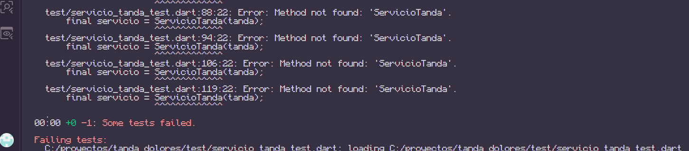

**Verde:**

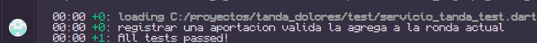

### Ronda 2: Rechazar una aportación repetida
**Rojo:**

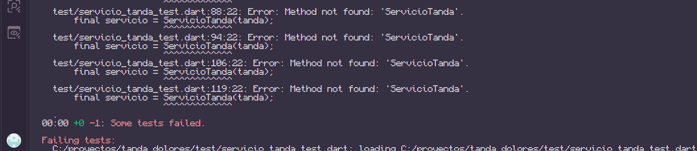

**Verde:**

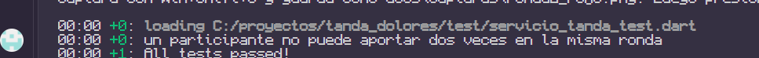

### Ronda 3: Rechazar aportaciones de quien no es participante
**Rojo:**

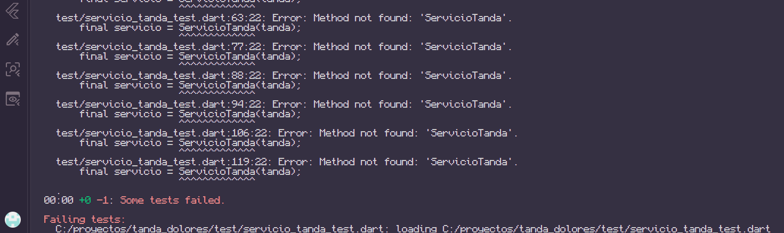

**Verde:**

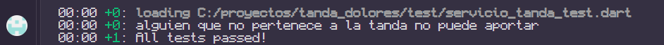

### Ronda 4: Detectar cuándo todos ya aportaron
**Rojo:**

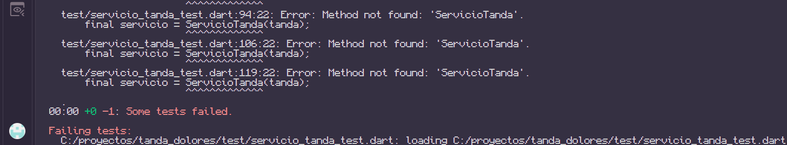

**Verde:**

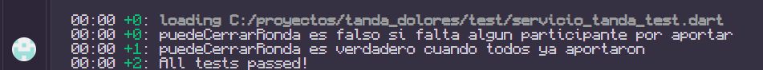

### Ronda 5: Cerrar la ronda y entregar el turno
**Rojo:**

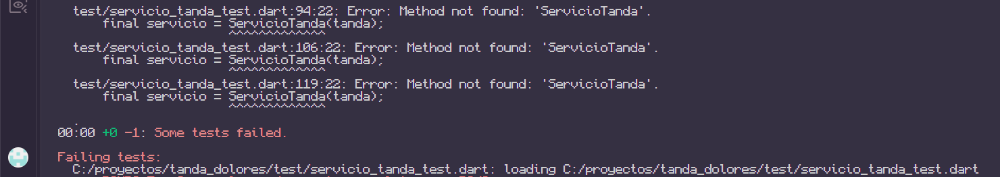

**Verde:**

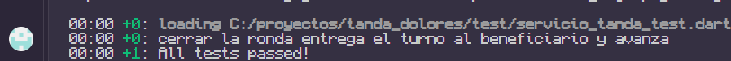

### Ronda 6: No cerrar la ronda si faltan aportaciones
**Rojo:**

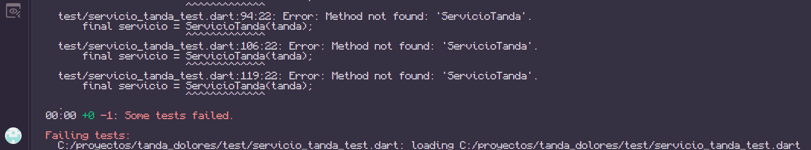

**Verde:**

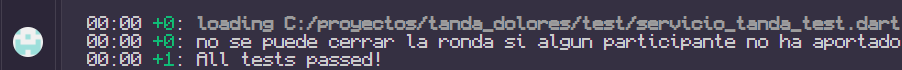

### Ronda 7: Detectar cuándo la tanda ha terminado
**Rojo:**

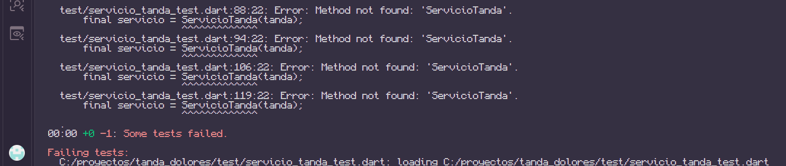

**Verde:**

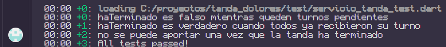

### Ronda 8: Refactor
En esta ronda no se agregan pruebas: se nombran las condiciones como reglas de negocio y las pruebas siguen en verde.

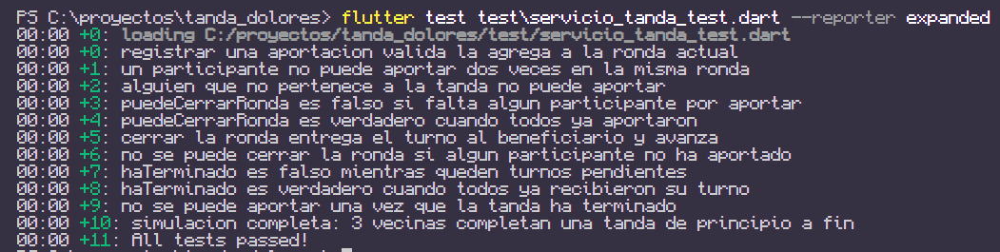

### Ronda 9: Prueba de integración (tanda completa)
**Rojo:**

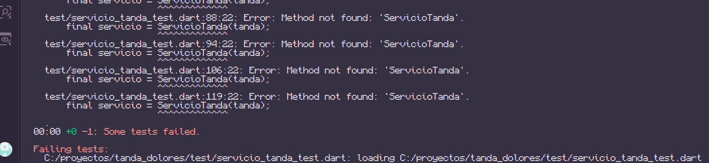

**Verde:**

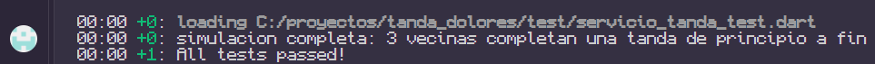

### Resultado final: todas las pruebas pasando
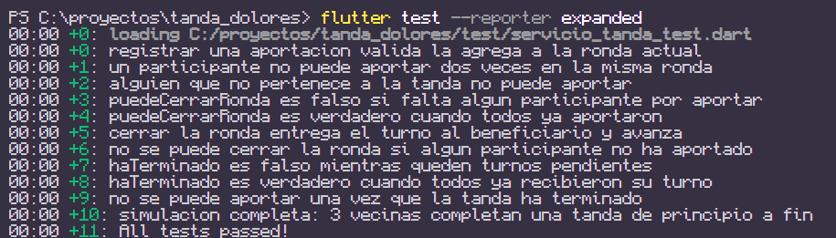

2. Aplicación en Funcionamiento (flutter run)
### Pantalla Principal

### Entrega de Turno (Animación)
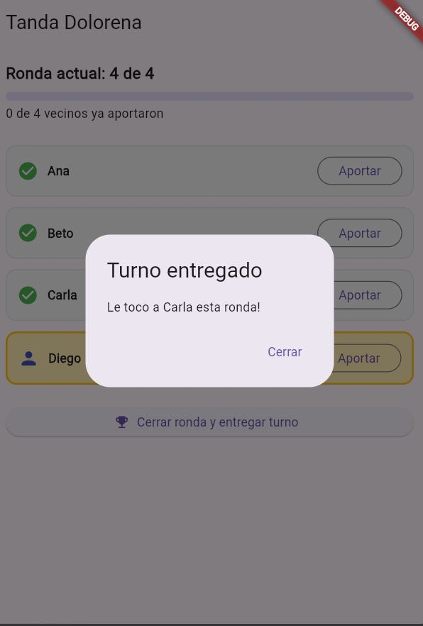
