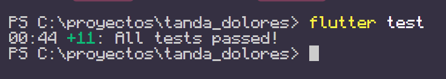
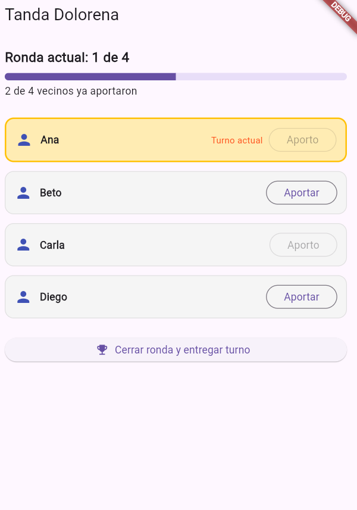

# 💰 Tanda Doloreña (TDD)Sistema de ahorro rotativo vecinal desarrollado en Flutter aplicando Test-Driven Development (TDD).

# 📸 Evidencias de Ejecución
1. Pruebas Automatizadas (flutter test)
Resultado de las 10 pruebas (unitarias y de integración) en verde:

2. Aplicación en Funcionamiento (flutter run)
Pantalla Principal

Entrega de Turno (Animación)

🚀 Comandos Rápidos
# Ejecutar pruebas TDD
flutter test

# Ejecutar la aplicación
flutter run

.